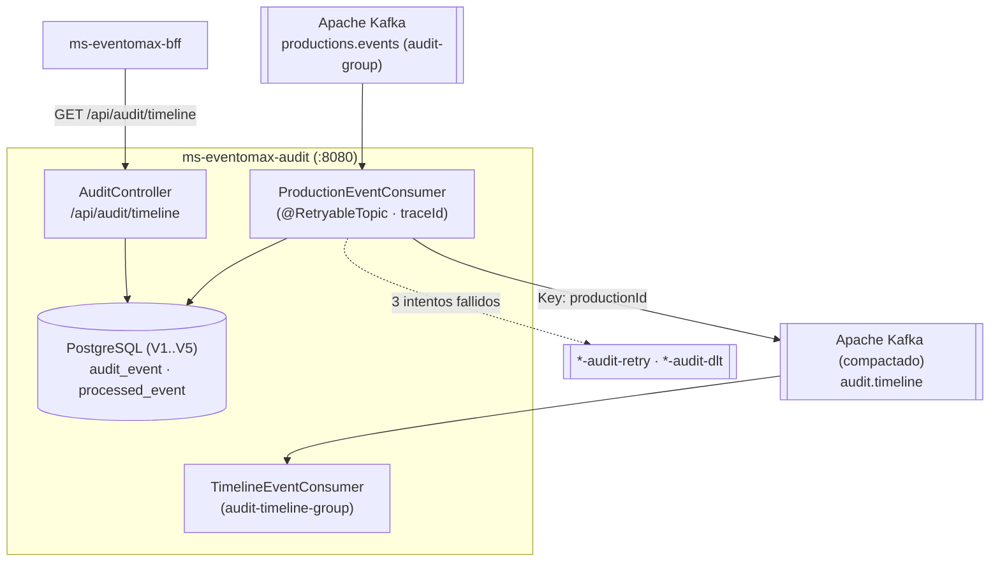

<a href="https://7dewsdyt7i.execute-api.us-east-1.amazonaws.com/kafka-ui/">
  
</a>

> **Caso de Estudio 8:** Plataforma B2B de Producción y Montaje de Eventos &nbsp;|&nbsp; **Asignatura:** Desarrollo Cloud Native (`DSY1107`) &nbsp;|&nbsp; **Equipo:** Ignacio Valeria, Benjamín Flores, Benjamín Espinoza

## Propósito del Repositorio

`ms-eventomax-audit` mantiene la bitácora inmutable de auditoría de eventos de dominio de **EventoMax** y expone la línea de tiempo operativa para los roles `Admin` y `Auditor`:

- **Consumo Resiliente con Retry y DLT (`ProductionEventConsumer`):** Escucha `productions.events` (`group-id: audit-group`) bajo `@RetryableTopic` (3 intentos con tópicos `productions.events-audit-retry` y `productions.events-audit-dlt`), valida estrictamente el sobre (`schemaVersion=1.0`, `eventId`, `type`, `timestamp`, `actor`, `payload`) y persiste de forma idempotente en PostgreSQL preservando `traceId`, `correlationId` y `source`.
- **Streaming Bidireccional en `audit.timeline`:** Cada evento auditado válido se republica particionado por `productionId` hacia el tópico compactado `audit.timeline` y es consumido en tiempo real por `TimelineEventConsumer` (`audit-timeline-group`).
- **Consulta Cronológica Paginada:** Expone `GET /api/audit/timeline` con filtros por `actor`, `type` y rango horario ISO (`from` / `to`), protegiendo el servicio ante consultas fuera de rango (`InvalidDateRangeException`).

## Accesos Relacionados (Demo AWS)

| Recurso | Enlace HTTPS | Acceso |
| :--- | :--- | :--- |
| **Apache Kafka UI** | [Abrir Kafka UI](https://7dewsdyt7i.execute-api.us-east-1.amazonaws.com/kafka-ui/) | Sin login (ver `productions.events`, `audit.timeline` y `*-audit-dlt`) |
| **Swagger UI (Tag `Auditoría`)** | [Abrir Swagger UI](https://7dewsdyt7i.execute-api.us-east-1.amazonaws.com/swagger-ui/index.html) | Lectura pública · `Bearer <JWT>` roles `Admin`, `Auditor` |

## Endpoints Expuestos (`expose 8080`)

| Método | Ruta | Roles Autorizados (vía BFF) | Descripción |
| :--- | :--- | :--- | :--- |
| `GET` | `/api/audit/timeline?actor=&from=&to=&type=&page=0&size=50` | `Admin`, `Auditor` | Línea de tiempo paginada (`size` `1..200`) de eventos de auditoría registrados |
| `GET` | `/actuator/health`, `/actuator/info` | Interno | Sondeo de salud del contenedor |

## Base de Datos y Migraciones Flyway (`V1..V5`)

| Versión | Script | Evolución del Esquema |
| :--- | :--- | :--- |
| `V1` | `V1__init_audit_schema.sql` | Crea `processed_event` y `audit_event` con índices en `actor`, `type`, `event_timestamp` |
| `V2` | `V2__unique_audit_event.sql` | Restricción de unicidad sobre `event_id` en `audit_event` |
| `V3` | `V3__audit_timeline_index.sql` | Índice compuesto `idx_audit_event_timestamp_id` descendente |
| `V4` | `V4__add_trace_and_correlation_id_to_audit_event.sql` | Añade columnas `trace_id` y `correlation_id` |
| `V5` | `V5__add_source_to_audit_event.sql` | Añade columna `source` para origen del evento |

## Stack Tecnológico

<table>
  <tr>
    <td align="center" width="20%">
      <br />
      <strong>Java 25 · Boot 4.1.1</strong>
    </td>
    <td align="center" width="20%">
      <picture>
        <source media="(prefers-color-scheme: dark)" srcset="docs/assets/tech/apache-kafka-dark.svg" />
        
      </picture><br />
      <strong>Kafka Streaming + DLT</strong>
    </td>
    <td align="center" width="20%">
      <br />
      <strong>PostgreSQL · Flyway</strong>
    </td>
    <td align="center" width="20%">
      <br />
      <strong>Entra ID OAuth2</strong>
    </td>
    <td align="center" width="20%">
      <br />
      <strong>Docker (512m)</strong>
    </td>
  </tr>
</table>

## Arquitectura del Módulo



## Variables de Entorno y Verificación

| Variable | Ejemplo | Descripción |
| :--- | :--- | :--- |
| `DB_URL` / `DB_USER` / `DB_PASSWORD` | `jdbc:postgresql://<HOST>:5432/eventomax?currentSchema=audit` | Conexión PostgreSQL y esquema `audit` |
| `KAFKA_BOOTSTRAP_SERVERS` | `ec2-kafka:9092` | Brokers del clúster Apache Kafka |
| `AUDIT_KAFKA_ENABLED` | `true` (con Kafka activo) / `false` (solo consulta DB) | Habilita los consumidores y el reenvío a `audit.timeline` |
| `ENTRA_ISSUER_URI` / `ENTRA_AUDIENCE` | `https://login.microsoftonline.com/<TENANT>/v2.0` | Validación JWT Entra ID |

```bash
# Ejecutar suite completa con PostgreSQL Testcontainers y Embedded Kafka
./mvnw -B -ntp verify

# Despliegue Docker (mem_limit: 512m)
docker compose --env-file .env.prod -f docker-compose.prod.yml up -d --build
```
