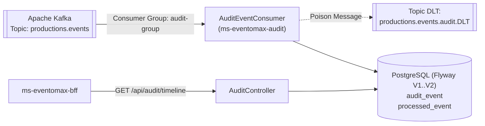

# ms-eventomax-audit — Microservicio de Auditoría Inmutable y Línea de Tiempo vía Kafka (EP2)

**Asignatura:** Desarrollo Cloud Native I (`DSY1107`)
**Caso de Estudio:** Caso 8 — Plataforma de Producción y Montaje de Eventos (**EventoMax**)
**Equipo:** Ignacio Valeria, Benjamín Flores, Benjamín Espinoza

---

## 1. Propósito del Repositorio y Rol en EventoMax

`ms-eventomax-audit` es el servicio responsable de registrar de forma inmutable e idempotente la bitácora forense de eventos de dominio de **EventoMax EP2**. Escucha el tópico `productions.events` en **Apache Kafka**, persiste la huella completa del sobre (`eventId`, `type`, `timestamp`, `traceId`, `correlationId`, `actor`, `productionId`, `payload`) en PostgreSQL y expone el endpoint paginado `/api/audit/timeline` para los roles `Admin` y `Auditor`.

En despliegues AWS EC2 donde Kafka se mantiene apagado para preservar memoria de la instancia `t3.large`, `ms-eventomax-audit` inicia limpiamente con `AUDIT_KAFKA_ENABLED=false` y sirve `GET /api/audit/timeline` directamente desde su esquema PostgreSQL (`audit`), retornando `200 OK` con lista vacía (`[]`) cuando aún no se han proyectado eventos desde Kafka (y mostrando en el frontend el aviso explícito *"No hay eventos para los filtros seleccionados en esta página"*, sin datos simulados).

---

## 2. Arquitectura del Módulo y Diagrama



---

## 3. Endpoints Expuestos

| Método | Ruta | Roles Autorizados | Descripción |
|---|---|---|---|
| `GET` | `/api/audit/timeline?productionId=&eventType=&from=&to=&page=0&size=20` | `Admin`, `Auditor` | Consulta paginada y filtrable de la línea de tiempo de eventos de dominio registrados. |
| `GET` | `/actuator/health`, `/actuator/info` | Público (Healthcheck interno) | Estado de salud del microservicio. |

---

## 4. Variables de Entorno Requeridas (`.env.prod.example`)

| Variable | Ejemplo Placeholder | Descripción |
|---|---|---|
| `DB_URL` | `jdbc:postgresql://<POSTGRES_HOST>:5432/eventomax?currentSchema=audit` | URL JDBC PostgreSQL |
| `DB_USER` | `eventomax_prod` | Usuario PostgreSQL |
| `DB_PASSWORD` | `<SECRET_DB_PASSWORD>` | Contraseña PostgreSQL |
| `KAFKA_BOOTSTRAP_SERVERS` | `kafka:9092` | Brokers Apache Kafka |
| `AUDIT_KAFKA_ENABLED` | `false` (en EC2 sin Kafka) o `true` (con Kafka activo) | Controla la activación del consumidor Kafka |
| `ENTRA_ISSUER_URI` | `https://login.microsoftonline.com/<TENANT_ID>/v2.0` | Issuer URI de Microsoft Entra ID |
| `ENTRA_AUDIENCE` | `api://a1a87bcd-fed7-4d65-83c3-338389b80093` | Audience del API en Entra ID |

---

## 5. Ejecución de Pruebas Automatizadas y Despliegue Docker

```bash
mvn clean verify
docker compose --env-file .env.prod -f docker-compose.prod.yml up -d --build
```

**Resultado certificado en EP2:** `Tests run: 32, Failures: 0, Errors: 0, Skipped: 0 — BUILD SUCCESS`. Presupuesto de memoria: `mem_limit: 512m`.
