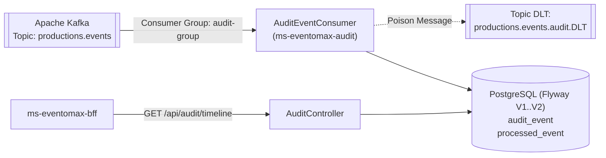

# ms-eventomax-audit — Microservicio de Auditoría Inmutable y Línea de Tiempo vía Kafka (EP2)

**Asignatura:** Desarrollo Cloud Native I (`DSY1107`)
**Caso de Estudio:** Caso 8 — Plataforma de Producción y Montaje de Eventos (**EventoMax**)
**Equipo:** Ignacio Valeria, Benjamín Flores, Benjamín Espinoza

---

## 1. Propósito del Repositorio y Rol en EventoMax

`ms-eventomax-audit` es el servicio responsable de registrar de forma inmutable e idempotente la bitácora forense de eventos de dominio de **EventoMax EP2**. Escucha el tópico `productions.events` en **Apache Kafka**, persiste la huella completa del sobre (`eventId`, `type`, `timestamp`, `traceId`, `correlationId`, `actor`, `productionId`, `payload`) en PostgreSQL y expone el endpoint paginado `/api/audit/timeline` para los roles `Admin` y `Auditor`.

---

## 2. Arquitectura del Módulo y Diagrama



---

## 3. Stack Tecnológico y Versiones Reales (`pom.xml`)

| Componente | Tecnología / Dependencia | Versión |
|---|---|---|
| Lenguaje | Java (Eclipse Temurin) | `25` |
| Framework Base | Spring Boot (`spring-boot-starter-parent`) | `4.1.1` |
| Mensajería de Eventos | `spring-kafka` | Boot `4.1.1` |
| Persistencia | Spring Data JPA + PostgreSQL + Flyway (`V1`, `V2`) | Boot `4.1.1` |
| Seguridad | `spring-boot-starter-security` + `oauth2-resource-server` | Boot `4.1.1` |
| Testing | JUnit 5, Testcontainers (`2.0.5`, PostgreSQL + Kafka), MockMvc | Boot `4.1.1` |

---

## 4. Cumplimiento de Rúbrica EP2 (Matriz Caso 8)

| Criterio de Evaluación EP2 | Implementación en `ms-eventomax-audit` | Estado |
|---|---|---|
| **Trazabilidad Distribuida y Forense** | Almacenamiento íntegro de `traceId`, `correlationId`, `eventId`, `actor` y `payload` JSON original para cada transición de estado y contratación de servicios. | **CUMPLIDO** |
| **Idempotencia y Resiliencia Kafka** | Deduplicación en tabla `processed_event` y derivación de mensajes corruptos hacia `productions.events.audit.DLT`. | **CUMPLIDO** |
| **Seguridad JWT Microsoft Entra ID** | Validación estricta de `issuer`, `audience`, scope `access_as_user` y roles `Admin` / `Auditor`. | **CUMPLIDO** |

---

## 5. Endpoints Expuestos

| Método | Ruta | Roles Autorizados | Descripción |
|---|---|---|---|
| `GET` | `/api/audit/timeline?productionId=&eventType=&from=&to=&page=0&size=20` | `Admin`, `Auditor` | Consulta paginada y filtrable de la línea de tiempo de eventos de dominio registrados. |
| `GET` | `/actuator/health`, `/actuator/info` | Público (Healthcheck interno) | Estado de salud del microservicio. |

---

## 6. Base de Datos y Migraciones Flyway

| Versión | Archivo | Descripción |
|---|---|---|
| `V1` | `V1__init_audit_schema.sql` | Crea tablas `audit_event` e índices de búsqueda por `production_id`, `event_type` y `occurred_at`. |
| `V2` | `V2__create_processed_event.sql` | Crea tabla `processed_event` para control de idempotencia del consumidor Kafka. |

---

## 7. Variables de Entorno Requeridas

| Variable | Ejemplo Placeholder | Descripción |
|---|---|---|
| `DB_URL` | `jdbc:postgresql://localhost:5435/eventomax_audit` | URL JDBC PostgreSQL |
| `DB_USER` | `audit_user` | Usuario PostgreSQL |
| `DB_PASSWORD` | `<SECRET_DB_PASSWORD>` | Contraseña PostgreSQL |
| `KAFKA_BOOTSTRAP_SERVERS` | `kafka:9092` | Brokers Apache Kafka |
| `AUDIT_KAFKA_ENABLED` | `true` | Activa el consumidor Kafka en despliegue productivo |
| `AUDIT_KAFKA_TOPIC` | `productions.events` | Tópico Kafka de eventos de dominio |
| `AUDIT_KAFKA_GROUP_ID` | `audit-group` | Consumer group de Audit |
| `ENTRA_ISSUER_URI` | `https://login.microsoftonline.com/<TENANT_ID>/v2.0` | Issuer URI de Microsoft Entra ID |
| `ENTRA_AUDIENCE` | `api://a1a87bcd-fed7-4d65-83c3-338389b80093` | Audience del API en Entra ID |

---

## 8. Ejecución Local y Pruebas Automatizadas

```bash
# Ejecutar suite completa de pruebas unitarias e integración con Testcontainers efímeros (32 tests)
mvn clean test
```

**Resultado certificado en EP2:** `Tests run: 32, Failures: 0, Errors: 0, Skipped: 0 — BUILD SUCCESS`.

---

## 9. Construcción y Despliegue Docker

```bash
docker build -t ms-eventomax-audit:ep2 .
docker compose -f docker-compose.prod.yml up -d --build
```

---

## 10. Estado Actual de Certificación EP2 y Trazabilidad Jira

- **Pruebas Automatizadas:** `32/32` aprobadas (`AuditKafkaTests`, `AuditSecurityAndTimelineTests`, `AuditApplicationTests`, `SwaggerProdTest`).
- **Historias Jira:** `EMX-70` / `EMX-91` (Consumidor Kafka de Auditoría y endpoint `/api/audit/timeline`).
